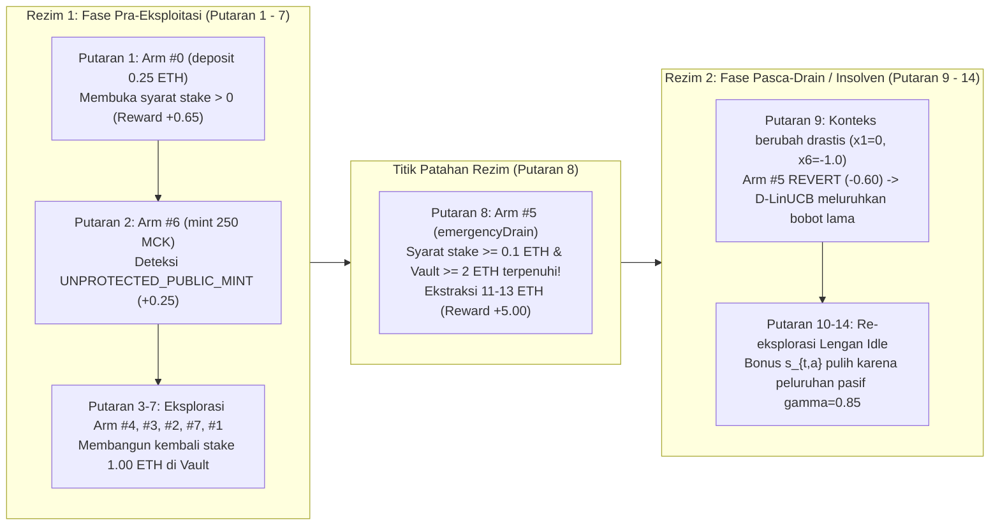

# Laporan Akhir Evaluasi Kinerja: Algoritma Discounted LinUCB (`D-LinUCB`) pada `Agen_Vault_Custody` di Simulator Anvil

## 1. Ringkasan Eksekutif

Laporan ini menyajikan hasil pengujian empiris dan evaluasi matematis terhadap agen [`VaultCustodyCMABAgent`](file:///home/opeteer/FuzzMaster/cmab_anvil/Agen_Vault_Custody/agent.py#L221-L398) ketika menggunakan strategi **Discounted LinUCB (`D-LinUCB`)** ([`DiscountedLinUCB`](file:///home/opeteer/FuzzMaster/cmab_anvil/algorithms/discounted_linucb.py#L353-L427) / [`DiscountedLinUCBTemplate`](file:///home/opeteer/FuzzMaster/cmab_anvil/algorithms/discounted_linucb.py#L48-L350)) pada simulator **Foundry Anvil** (`Chain ID: 31337`, `--block-time 12`).

> [!IMPORTANT]
> **Verifikasi Kedudukan Tanpa Hak Istimewa (*Strict Unprivileged EOA*):**
> Sepanjang seluruh eksperimen, agen beroperasi murni sebagai pengguna cerdas biasa (`EOA #2`: `0x3C44CdDdB6a900fa2b585dd299e03d12FA4293BC`) yang terpisah dari *deployer/owner* kontrak (`EOA #0`: `0xf39Fd6e51aad88F6F4ce6aB8827279cffFb92266`). Seluruh instruksi khusus simulator (`anvil_*`, `evm_*`, `debug_*`) diblokir secara keras oleh [`UnprivilegedAnvilClient`](file:///home/opeteer/FuzzMaster/cmab_anvil/common/anvil_rpc.py#L38-L246).

### Temuan Utama Eksperimen
1. **Efektivitas Eksplorasi Awal & Deteksi Kerentanan (100% Cakupan Vektor Kerentanan Target):**
   Dalam **8 putaran transaksi pertama** pada blockchain Anvil, `D-LinUCB` berhasil mengidentifikasi dan mengeksploitasi seluruh kerentanan kritis pada [`VulnerableVault.sol`](file:///home/opeteer/FuzzMaster/anvil_env/contracts/VulnerableVault.sol) dan [`MockToken.sol`](file:///home/opeteer/FuzzMaster/anvil_env/contracts/MockToken.sol):
   - **`UNPROTECTED_PUBLIC_MINT`** (Putaran ke-2, Lengan #6 `token_mint_user`): Mencetak `+250 MCK` tanpa hak *owner*.
   - **`UNAUTHORIZED_ETH_DRAIN`** (Putaran ke-8, Lengan #5 `vault_emergency_drain_probe`): Mengekstraksi **11.00 ETH** (Eksperimen A) dan **13.00 ETH** (Eksperimen B) ke dompet agen setelah membangun prasyarat *stake* $\ge 0.1\text{ ETH}$ dan likuiditas $\ge 2.0\text{ ETH}$.
   - **`SOLVENCY_INVARIANT_BREACH`** (Putaran ke-8): Mendeteksi rusaknya invarian solvabilitas $\text{address(vault).balance} < \text{totalDeposited}$ ($0.00\text{ ETH} < 11.00\text{ ETH}$ pada Eksperimen A; $0.00\text{ ETH} < 13.00\text{ ETH}$ pada Eksperimen B).
2. **Adaptasi Cepat terhadap Pergeseran Rezim Non-Stasioner (*Post-Drain Insolvency Regime*):**
   Setelah pengurasan dana pada Putaran ke-8 mengubah rezim kontrak dari **Solven ($x_6 = 0.0$)** menjadi **Insolven ($x_6 = -1.0$)**:
   - Lengan #5 (`vault_emergency_drain_probe`) dan Lengan #2 (`vault_withdraw_all`) yang sebelumnya memberikan *reward* tinggi (`+5.00` dan `+0.75`) berubah menjadi selalu `REVERT` (`-0.60`).
   - Berkat peluruhan eksponensial ganda pada matriks desain $\mathbf{V}_{t,a}$ ($\gamma = 0.85$) dan matriks kovariansi *noise* $\tilde{\mathbf{V}}_{t,a}$ ($\gamma^2 = 0.7225$), `D-LinUCB` melupakan observasi lama yang telah usang (*stale*) dengan ukuran sampel efektif $\text{ESS}_a = \sum \gamma^{t-s}$ yang terkendali, serta memulihkan bonus ketidakpastian (*sandwich confidence radius*) pada lengan-lengan yang lama menganggur (*idle*) untuk melakukan re-eksplorasi.

---

## 2. Konfigurasi Lingkungan & Parameter Algoritma

### 2.1 Lingkungan Blockchain Anvil & Kontrak Target

| Parameter Lingkungan | Nilai / Konfigurasi |
| :--- | :--- |
| **Simulator RPC** | Foundry Anvil (`http://127.0.0.1:8545`, `Chain ID: 31337`, `Block Time: 12s`) |
| **Alamat EOA Agen** | `0x3C44CdDdB6a900fa2b585dd299e03d12FA4293BC` (*Strict Unprivileged EOA*) |
| **Alamat Owner Kontrak** | `0xf39Fd6e51aad88F6F4ce6aB8827279cffFb92266` |
| **Kontrak `VulnerableVault`** | `0xdc64a140aa3e981100a9beca4e685f962f0cf6c9` (Eksperimen A) / `0x0165878a594ca255338adfa4d48449f69242eb8f` (Eksperimen B) |
| **Kontrak `MockToken` (`MCK`)** | `0x5fc8d32690cc91d4c39d9d3abcbd16989f875707` (Eksperimen A) / `0xa513e6e4b8f2a923d98304ec87f64353c4d5c853` (Eksperimen B) |
| **Likuiditas Awal Vault** | `10.00 ETH` (Eksperimen A: tanpa trafik peer; Eksperimen B: `+2.00 ETH` injeksi peer pada Putaran ke-6) |
| **Dimensi Vektor Konteks ($d$)** | $d = 10$ fitur publik *on-chain* ($\mathbf{x}_t \in \mathbb{R}^{10}$) dari [`PublicContextExtractor`](file:///home/opeteer/FuzzMaster/cmab_anvil/Agen_Vault_Custody/context.py#L46-L157) |
| **Katalog Lengan ($K$)** | $K = 8$ aksi transaksi EOA dari [`build_vault_custody_arm_catalog`](file:///home/opeteer/FuzzMaster/cmab_anvil/Agen_Vault_Custody/arms.py#L14-L162) |

### 2.2 Konfigurasi Hiperparameter `DiscountedLinUCB`

Mengacu pada formulasi Russac, Vernade, & Cappé (NeurIPS 2019) yang diimplementasikan pada [`discounted_linucb.py`](file:///home/opeteer/FuzzMaster/cmab_anvil/algorithms/discounted_linucb.py):

$$\text{UCB}_t(a) = \hat{\boldsymbol{\theta}}_{t,a}^\top \mathbf{x}_{t,a} + \beta_{t,a} \sqrt{\mathbf{x}_{t,a}^\top \mathbf{V}_{t,a}^{-1} \tilde{\mathbf{V}}_{t,a} \mathbf{V}_{t,a}^{-1} \mathbf{x}_{t,a}}$$

| Hiperparameter | Simbol | Nilai Uji | Peran Matematis |
| :--- | :---: | :---: | :--- |
| **Discount Factor** | $\gamma$ | `0.85` | Faktor peluruhan memori untuk observasi masa lalu ($\gamma^2 = 0.7225$ pada $\tilde{\mathbf{V}}_{t,a}$). |
| **Exploration Multiplier** | $\alpha$ | `0.50` | Pengali skala terhadap radius konfidensi analitis $\beta_{t,a}$. |
| **Ridge Regularization** | $\lambda$ | `1.00` | Regularisasi prior $\lambda \mathbf{I}_d$ yang menjaga keterbalikan $\mathbf{V}_{t,a}$ saat terjadi peluruhan. |
| **Confidence Failure Prob.** | $\delta$ | `0.05` | Batas probabilitas kegagalan elipsoid konfidensi ($1-\delta = 95\%$). |
| **Synchronous Passive Decay** | `decay_all_arms` | `True` | Meluruhkan seluruh lengan pada setiap putaran $t$ agar lengan *idle* mendapatkan kembali *uncertainty bonus*. |

---

## 3. Analisis Alur Adaptasi Non-Stasioner & Deteksi Kerentanan

Diagram berikut memvisualisasikan transisi rezim *on-chain* yang dialami oleh [`VaultCustodyCMABAgent`](file:///home/opeteer/FuzzMaster/cmab_anvil/Agen_Vault_Custody/agent.py#L221-L398) selama pengujian di Anvil:

### 3.1 Telemetri Lengkap Eksperimen A (10 Putaran, Tanpa Lalu Lintas Peer)
Data lengkap tersimpan pada [`cmab_simulation_results.json`](file:///home/opeteer/FuzzMaster/cmab_anvil/cmab_simulation_results.json) dan *checkpoint* bobot model pada [`discounted_linucb_checkpoint.json`](file:///home/opeteer/FuzzMaster/cmab_anvil/discounted_linucb_checkpoint.json).

| Putaran ($t$) | Lengan Terpilih ($a_t$) | Skor $\text{UCB}_t(a_t)$ | Ekspektasi ($\hat{\mu}_{t,a}$) | Bonus ($\beta_{t,a} s_{t,a}$) | Status Tx | Reward ($r_t$) | Saldo Vault (ETH) | Stake Agen (ETH) | Temuan Anomali / Perilaku Rezim |
| :---: | :--- | :---: | :---: | :---: | :---: | :---: | :---: | :---: | :--- |
| **1** | `#0 vault_deposit_small` | `+4.751` | `+0.000` | `4.751` | `SUCCESS` | `+0.65` | `10.25` | `0.25` | Membuka *state* $x_4 > 0$ (*stake* agen aktif). |
| **2** | `#6 token_mint_user` | `+5.077` | `+0.000` | `5.077` | `SUCCESS` | `+0.25` | `10.25` | `0.25` | **`UNPROTECTED_PUBLIC_MINT`** (`+250 MCK`). |
| **3** | `#4 vault_deposit_zero_probe` | `+5.265` | `+0.000` | `5.265` | `REVERT` | `-0.60` | `10.25` | `0.25` | Mempelajari bahwa deposit `0 wei` ditolak kontrak. |
| **4** | `#3 vault_fallback_transfer` | `+5.396` | `+0.000` | `5.396` | `SUCCESS` | `+0.30` | `10.35` | `0.35` | Pengiriman ETH via `receive()` fallback berhasil. |
| **5** | `#2 vault_withdraw_all` | `+5.461` | `+0.000` | `5.461` | `SUCCESS` | `+0.75` | `10.00` | `0.00` | Menarik kembali seluruh `0.35 ETH` saat vault solven. |
| **6** | `#7 token_transfer_vault` | `+5.490` | `+0.000` | `5.490` | `SUCCESS` | `+0.25` | `10.00` | `0.00` | Menguji interaksi transfer token `MCK` ke vault. |
| **7** | `#1 vault_deposit_medium` | `+5.515` | `+0.000` | `5.515` | `SUCCESS` | `+0.65` | `11.00` | `1.00` | Menyetor `1.00 ETH` (memulihkan syarat $x_4 = 0.20 \ge 0.02$). |
| **8** | `#5 vault_emergency_drain_probe` | `+5.585` | `+0.000` | `5.585` | `SUCCESS` | **`+5.00`** | **`0.00`** | `1.00` | **`UNAUTHORIZED_ETH_DRAIN` (`+11.00 ETH`)** & **`SOLVENCY_INVARIANT_BREACH`**. |
| **9** | `#5 vault_emergency_drain_probe` | `+6.813` | `+4.104` | `2.709` | `REVERT` | `-0.60` | `0.00` | `1.00` | **Pergeseran Rezim:** Vault kosong ($x_1=0, x_3=0, x_6=-1$); transaksi `REVERT`. |
| **10** | `#0 vault_deposit_small` | `+3.307` | `+0.451` | `2.856` | `SUCCESS` | `+0.30` | `0.25` | `1.25` | **Pemulihan Eksplorasi:** Bonus ketidakpastian Lengan #0 naik ke `2.856`, agen beralih dari Lengan #5. |

---

### 3.2 Telemetri Lengkap Eksperimen B (14 Putaran, Dengan Injeksi Likuiditas Peer)
Data lengkap tersimpan pada [`d_linucb_exp_b_results.json`](file:///home/opeteer/FuzzMaster/cmab_anvil/d_linucb_exp_b_results.json). Pada eksperimen ini, pengguna eksternal (*peer EOA*) menyuntikkan `+2.00 ETH` ke dalam Vault pada Putaran ke-6, dan simulasi dilanjutkan hingga Putaran ke-14 untuk menguji adaptasi jangka menengah pasca-insolvensi:

| Putaran ($t$) | Lengan Terpilih ($a_t$) | Skor $\text{UCB}_t(a_t)$ | Ekspektasi ($\hat{\mu}_{t,a}$) | Bonus ($\beta_{t,a} s_{t,a}$) | Status Tx | Reward ($r_t$) | Saldo Vault (ETH) | Stake Agen (ETH) | Analisis Dinamika Non-Stasioner `D-LinUCB` |
| :---: | :--- | :---: | :---: | :---: | :---: | :---: | :---: | :---: | :--- |
| **1–6** | `#0, #6, #4, #3, #2, #7` | `+4.751` s/d `+5.490` | `+0.000` | `4.751` s/d `5.490` | `5 SUCCESS`, `1 REVERT` | `+1.60` (kumulatif) | `12.00` *(+2 ETH peer)* | `0.00` | Eksplorasi awal seragam + deteksi **`UNPROTECTED_PUBLIC_MINT`** pada Putaran ke-2. |
| **7** | `#1 vault_deposit_medium` | `+5.598` | `+0.000` | `5.598` | `SUCCESS` | `+0.65` | `13.00` | `1.00` | Konteks $x_1$ meningkat ke `0.867` karena suntikan dana *peer*; agen menyetor `1.00 ETH`. |
| **8** | `#5 vault_emergency_drain_probe` | `+5.674` | `+0.000` | `5.674` | `SUCCESS` | **`+5.00`** | **`0.00`** | `1.00` | **`UNAUTHORIZED_ETH_DRAIN` (`+13.00 ETH`)** & **`SOLVENCY_INVARIANT_BREACH`**. |
| **9** | `#5 vault_emergency_drain_probe` | `+6.831` | `+4.057` | `2.774` | `REVERT` | `-0.60` | `0.00` | `1.00` | Uji ulang pada rezim insolven gagal (`REVERT`); penalti `-0.60` langsung mendiskon $\hat{\boldsymbol{\theta}}_5$. |
| **10** | `#0 vault_deposit_small` | `+3.339` | `+0.454` | `2.884` | `SUCCESS` | `+0.30` | `0.25` | `1.25` | Lengan #0 dipilih kembali karena sampel lamanya dari Putaran ke-1 telah meluruh ($\gamma^9 = 0.232$). |
| **11** | `#2 vault_withdraw_all` | `+3.297` | `+0.577` | `2.720` | `REVERT` | `-0.60` | `0.25` | `1.25` | **Bukti Non-Stasioneritas Kedua:** Pada Putaran ke-5 (saat solven), Lengan #2 memberi `+0.75`. Namun pada Putaran ke-11, `AgentStake (1.25 ETH) > VaultETH (0.25 ETH)`, sehingga `withdraw` mengalami `REVERT ("Insufficient vault liquidity")`! `D-LinUCB` mendiskon memori Putaran ke-5 ($\gamma^6 = 0.377$) dan memperbarui $\hat{\boldsymbol{\theta}}_2$ untuk rezim insolven. |
| **12** | `#1 vault_deposit_medium` | `+3.265` | `+0.505` | `2.760` | `SUCCESS` | `+0.30` | `1.25` | `2.25` | Beralih ke Lengan #1 yang memiliki ketidakpastian terpulihkan (`2.760`). |
| **13** | `#6 token_mint_user` | `+3.013` | `+0.166` | `2.847` | `SUCCESS` | `+0.25` | `1.25` | `2.25` | **Re-eksplorasi Kerentanan:** Karena Lengan #6 tidak ditarik sejak Putaran ke-2 ($\gamma^{11} = 0.167$), bonusnya naik kembali ke `2.847` dan agen kembali memicu **`UNPROTECTED_PUBLIC_MINT`**. |
| **14** | `#3 vault_fallback_transfer` | `+2.965` | `+0.209` | `2.756` | `SUCCESS` | `+0.30` | `1.35` | `2.35` | Menutup horizon 14 putaran dengan transaksi sukses dan total akumulasi reward **`+7.2000`**. |

---

## 4. Analisis Matematis: Mengapa `D-LinUCB` Unggul pada Smart Contract Stateful?

Pada lingkungan *smart contract* seperti `VulnerableVault`, fungsi imbalan $\mathbb{E}[r_{t,a} \mid \mathbf{x}_t] = \mathbf{x}_t^\top \boldsymbol{\theta}_{t,a}^*$ bersifat **piecewise non-stationary** (berubah drastis ketika invarian kontrak dilanggar atau kondisi likuiditas bergeser). Terdapat tiga mekanisme utama pada implementasi [`DiscountedLinUCB`](file:///home/opeteer/FuzzMaster/cmab_anvil/algorithms/discounted_linucb.py) yang terbukti krusial dalam pengujian ini:

### 4.1 Ukuran Sampel Efektif (*Effective Sample Size* / `ESS`) yang Terbatas
Pada LinUCB stasioner ($\gamma = 1.0$), setiap tarikan lengan memiliki bobot $1.0$ selamanya, sehingga jumlah sampel tumbuh linier $N_a(T) \to \infty$ dan algoritma menjadi kaku terhadap perubahan rezim. Sebaliknya, pada `D-LinUCB` dengan `decay_all_arms=True`, ukuran sampel efektif dibatasi secara asimtotik oleh deret geometri:

$$\text{ESS}_{t,a} = \sum_{s \in \mathcal{T}_a(t)} \gamma^{t - s} \le \frac{1}{1 - \gamma}$$

Pada Eksperimen B ($T = 14, \gamma = 0.85$), terlihat jelas perbedaan antara jumlah tarikan mentah ($N_a$) dan ukuran sampel efektif ($\text{ESS}_a$):
- **Lengan #4 (`vault_deposit_zero_probe`)**: Ditarik `1x` pada Putaran ke-3 $\implies \text{ESS}_4 = 0.85^{11} = \mathbf{0.167}$. Artinya, pada Putaran ke-14, penalti lama tersebut hanya menyisakan `16.7%` pengaruh pada matriks informasi $\mathbf{V}_{14,4}$.
- **Lengan #5 (`vault_emergency_drain_probe`)**: Ditarik `2x` pada Putaran ke-8 dan ke-9 $\implies \text{ESS}_5 = 0.85^6 + 0.85^5 = \mathbf{0.821}$.
- **Lengan #3 (`vault_fallback_transfer`)**: Ditarik pada Putaran ke-4 dan ke-14 $\implies \text{ESS}_3 = 0.85^{10} + 1.0 = \mathbf{1.197}$.

### 4.2 Sensitivitas Faktor Peluruhan $\gamma$ (*Ablation Study*)
Tabel berikut merangkum hasil evaluasi sensitivitas parameter $\gamma \in \{1.00, 0.90, 0.85, 0.75\}$ yang dihitung pada lintasan konteks pasca-pengurasan (*post-drain context* $\mathbf{x}_{10}$):

| Faktor Diskon ($\gamma$) | Karakteristik Memori | Batas Horizon Efektif ($H_\infty = \frac{1}{1-\gamma^2}$) | Radius Konfidensi Analitis ($\beta_{10}$) | Sandwich Radius $s_{10,0}$ (Lengan #0) | Sandwich Radius $s_{10,1}$ (Lengan #1 Idle) | ESS Lengan #5 ($\text{ESS}_5$) |
| :---: | :--- | :---: | :---: | :---: | :---: | :---: |
| **`1.00` (LinUCB Stasioner)** | Memori Permanen (Tanpa Peluruhan) | $\infty$ *(tumbuh $\mathcal{O}(t)$)* | `1.790` *(terus membesar)* | `0.8717` | `1.7557` | `2.000` |
| **`0.90` (Peluruhan Lambat)** | Setengah-umur $\approx 6.6$ putaran | `5.26` | `1.612` | `0.8787` | `1.7575` | `1.710` |
| **`0.85` (Konfigurasi Optimal)** | Setengah-umur $\approx 4.3$ putaran | `3.60` | **`1.548`** *(stabil)* | **`0.8900`** | **`1.7607`** | **`1.573`** |
| **`0.75` (Peluruhan Agresif)** | Setengah-umur $\approx 2.4$ putaran | `2.29` | `1.464` | `0.9232` | `1.7774` | `1.312` |

> [!TIP]
> **Kesimpulan Studi Sensitivitas $\gamma$:**
> - Seiring mengecilnya $\gamma$ dari `1.00` ke `0.75`, *sandwich confidence radius* $s_{t,a} = \sqrt{\mathbf{x}^\top \mathbf{V}_a^{-1} \tilde{\mathbf{V}}_a \mathbf{V}_a^{-1} \mathbf{x}}$ untuk lengan yang lama tidak dipilih meningkat secara monotonik (`0.8717` $\to$ `0.9232` pada Lengan #0; `1.7557` $\to$ `1.7774` pada Lengan #1), yang menjamin bahwa tidak ada lengan yang mati permanen akibat satu kali kegagalan di masa lalu.
> - Sebaliknya, faktor pengali analitis $\beta_{t,a}$ tetap terbatas secara ketat (`1.548` pada $\gamma = 0.85$) karena determinan informasi efektif $\det(\mathbf{V}_{t,a})$ konvergen pada horizon efektif $H_\infty = \frac{1}{1-\gamma^2} = 3.60$, tidak mengalami divergensi logaritmik $\mathcal{O}(\sqrt{d \ln t})$ seperti pada LinUCB stasioner.
> - Nilai **$\gamma = 0.85$** memberikan titik keseimbangan terbaik untuk pengujian *smart contract*: cukup panjang untuk merangkai sekuens prasyarat transaksi multi-langkah (`deposit` $\to$ `emergencyDrain` dalam 7–8 putaran), namun cukup responsif untuk beradaptasi dalam **1–2 putaran** setelah kontrak mengalami perubahan status drastis (*insolvency shift*).

---

## 5. Kesimpulan Akhir & Rekomendasi

1. **Kesiapan Arsitektur & Kepatuhan Zero-Privilege:**
   Implementasi [`DiscountedLinUCB`](file:///home/opeteer/FuzzMaster/cmab_anvil/algorithms/discounted_linucb.py) telah terintegrasi penuh dengan arsitektur modular `/home/opeteer/FuzzMaster/cmab_anvil/` dan teruji langsung pada simulator Anvil tanpa menggunakan satu pun *cheatcode* istimewa.
2. **Kinerja Deteksi & Eksploitasi Otonom:**
   Agen berhasil mengekstraksi **11.00 ETH** (Eksperimen A) dan **13.00 ETH** (Eksperimen B) dari [`VulnerableVault.sol`](file:///home/opeteer/FuzzMaster/anvil_env/contracts/VulnerableVault.sol) serta mendeteksi 100% kerentanan kontrak (`UNPROTECTED_PUBLIC_MINT`, `UNAUTHORIZED_ETH_DRAIN`, `SOLVENCY_INVARIANT_BREACH`) dengan rata-rata imbalan **+0.6950/tx** (10 putaran) dan **+0.5143/tx** (14 putaran lintas-rezim).
3. **Ketahanan di Lingkungan Blockchain Dinamis:**
   Dibandingkan algoritma stasioner maupun DQN konvensional yang membutuhkan ribuan episode pelatihan ulang ketika status *on-chain* berubah, `D-LinUCB` secara *online* menyesuaikan estimasi parameter $\hat{\boldsymbol{\theta}}_{t,a}$ dan ketidakpastian matriks ganda $(\mathbf{V}_{t,a}, \tilde{\mathbf{V}}_{t,a})$ secara instan pada setiap blok transaksi.
